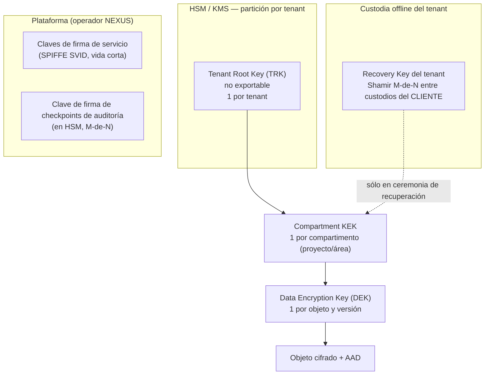

# 2. Especificación criptográfica preliminar

> Estado: **borrador para revisión por criptógrafo** [VALIDACIÓN EXTERNA]. Nada de este documento está implementado.

## 2.1 Principios

1. **Sólo primitivas estandarizadas** a través de bibliotecas auditadas (ver §2.7). Prohibido implementar primitivas.
2. **Separación de dominios**: toda derivación usa un contexto (`info`/AAD) que incluye propósito, tenant, versión de algoritmo e identificador de objeto.
3. **Una clave, un propósito**: ninguna clave sirve a la vez para cifrar y firmar, ni para dos tenants.
4. **Agilidad**: cada artefacto cifrado o firmado lleva un identificador de suite (`suite_id`) y versión de formato.
5. **Híbrido donde la vida útil lo justifique**: confidencialidad > 10 años o firmas raíz.
6. **Fallar cerrado**: un `suite_id` desconocido o deprecado se rechaza; nunca se "degrada" en silencio.

## 2.2 Suites criptográficas iniciales

| suite_id | Propósito | Primitivas | Estado |
|---|---|---|---|
| `NC-AEAD-1` | Cifrado de datos | AES-256-GCM, nonce aleatorio 96 bits, clave de datos única por objeto/versión | Propuesto |
| `NC-AEAD-2` | Cifrado de datos en cliente | XChaCha20-Poly1305 | Propuesto |
| `NC-WRAP-1` | Envoltura DEK→KEK en HSM | AES-256-KWP (SP 800-38F) | Propuesto |
| `NC-WRAP-2` | Envoltura a destinatario (compartir, E2EE) | HPKE (RFC 9180) con KEM híbrido X25519+ML-KEM-768, HKDF-SHA-256, AES-256-GCM [VERIFICAR estado del registro IANA del KEM híbrido] | Propuesto, experimental |
| `NC-SIG-1` | Firma de eventos / tokens | Ed25519 | Propuesto |
| `NC-SIG-2` | Firma de larga vida (checkpoints, CA raíz, políticas) | Compuesta Ed25519 + ML-DSA-65 (ambas deben verificar) | Propuesto, experimental |
| `NC-SIG-3` | Firma de firmware / raíz offline | SLH-DSA-SHA2-128s o LMS (SP 800-208) | Propuesto |
| `NC-TLS-1` | Transporte | TLS 1.3, grupo `X25519MLKEM768`, fallback `X25519` sólo si la política del tenant lo permite | Propuesto |
| `NC-KDF-1` | Derivación | HKDF-SHA-256 / SHA-384 | Propuesto |
| `NC-HASH-1` | Integridad / Merkle | SHA-256 (con prefijo de dominio 0x00 hoja / 0x01 nodo, como RFC 6962) | Propuesto |
| `NC-PWD-1` | Contraseñas (sólo legado/recuperación) | Argon2id (RFC 9106) con parámetros calibrados | Propuesto |

## 2.3 Jerarquía de claves (sin clave maestra universal)



Propiedades:
- **No existe una clave por encima de las TRK.** El operador de la plataforma no posee una clave capaz de desenvolver las TRK de todos los tenants. Cada TRK vive en una partición separada del HSM/KMS con política de acceso propia.
- Compromiso de una **DEK** → expone un objeto-versión.
- Compromiso de una **Compartment KEK** → expone un compartimento de un tenant.
- Compromiso de la **TRK** requiere comprometer el HSM o su política de acceso → expone un tenant.
- Modo **BYOK/HYOK** opcional: la TRK vive en el HSM/KMS del cliente; NEXUS sólo pide operaciones de desenvoltura, que el cliente puede revocar (corte de acceso inmediato).

## 2.4 Formato de objeto cifrado (borrador)

```
NCOBJ v1
  header:
    format_version : u8 = 1
    suite_id       : u16           # NC-AEAD-1, ...
    tenant_id      : 16 bytes      # UUID
    compartment_id : 16 bytes
    object_id      : 16 bytes
    object_version : u64
    kek_id         : bytes         # identificador + versión de la KEK
    wrapped_dek    : bytes
    nonce          : 12|24 bytes
  ciphertext       : bytes
  tag              : 16 bytes
AAD = canonical(header sin wrapped_dek) || "NCOBJ-v1"
```

El AAD vincula el texto cifrado a su tenant, compartimento, objeto y versión: un atacante con acceso de escritura al almacenamiento no puede mover un blob cifrado de un tenant a otro ni hacer *rollback* de versión sin detección.

## 2.5 Rotación y agilidad criptográfica

| Evento | Acción | Impacto |
|---|---|---|
| Rotación programada de KEK (p. ej. anual) | Nueva versión de KEK; nuevas DEK se envuelven con ella; re-envoltura perezosa de DEK antiguas | Sin re-cifrado de datos |
| Compromiso sospechado de KEK | Nueva KEK + re-envoltura forzosa + revocación de la antigua tras verificación | Sin re-cifrado si DEKs no comprometidas |
| Compromiso de DEK | Re-cifrado del objeto afectado | Local |
| Deprecación de algoritmo (p. ej. `NC-SIG-1` sin PQ) | 1) Nueva suite en modo "aceptar" 2) Pasar a "emitir" 3) Re-firmar artefactos de larga vida 4) Rechazar la antigua | Planificado por fases, medible con inventario |
| Ruptura de algoritmo (emergencia) | Runbook de emergencia con inventario criptográfico (CBOM) | Depende del inventario → **el inventario es obligatorio desde Fase 1** |

**Inventario criptográfico (CBOM):** cada servicio declara qué suites usa; CI rechaza el uso de primitivas fuera de la lista permitida (regla de análisis estático).

## 2.6 Aleatoriedad

- Fuente: CSPRNG del sistema operativo (`getrandom(2)`, `BCryptGenRandom`) o DRBG del HSM. Nunca generadores de espacio de usuario propios.
- En VMs clonadas/snapshots: re-semillado obligatorio al restaurar (riesgo de nonces repetidos).

## 2.7 Bibliotecas candidatas (a evaluar, no elegidas)

| Lenguaje | Biblioteca | Notas |
|---|---|---|
| Rust | `aws-lc-rs` (AWS-LC, con módulo FIPS validado [VERIFICAR certificado vigente]) | AEAD, ECDH, firmas, ML-KEM |
| Rust | `rustls` | TLS 1.3 con híbrido PQ |
| Rust | RustCrypto (`aes-gcm`, `chacha20poly1305`, `ml-kem`, `ml-dsa`, `slh-dsa`) | Revisar estado de auditoría de cada crate PQ [VERIFICAR] |
| C | liboqs (Open Quantum Safe) | Investigación; no para producción según el propio proyecto [VERIFICAR] |
| Go | `crypto/*` estándar (incluye `crypto/mlkem` desde Go 1.24) | Servicios de infraestructura |
| TS/JS | WebCrypto + `@noble/*` | Cliente web; `@noble` auditado [VERIFICAR alcance] |

Criterios de aceptación: auditoría pública reciente, tiempo constante documentado, vectores de prueba oficiales (NIST ACVP / Wycheproof) pasando en CI, mantenimiento activo.

## 2.8 Lo que esta especificación NO garantiza

Usar AES-256 o ML-KEM no hace seguro al sistema. Los fallos realistas están en: gestión de nonces, control de acceso a las operaciones de desenvoltura, registros que filtran texto plano, claves en memoria de procesos comprometidos, recuperación mal diseñada y errores de autorización. Esos riesgos se tratan en el [modelo de amenazas](04-modelo-amenazas.md).
