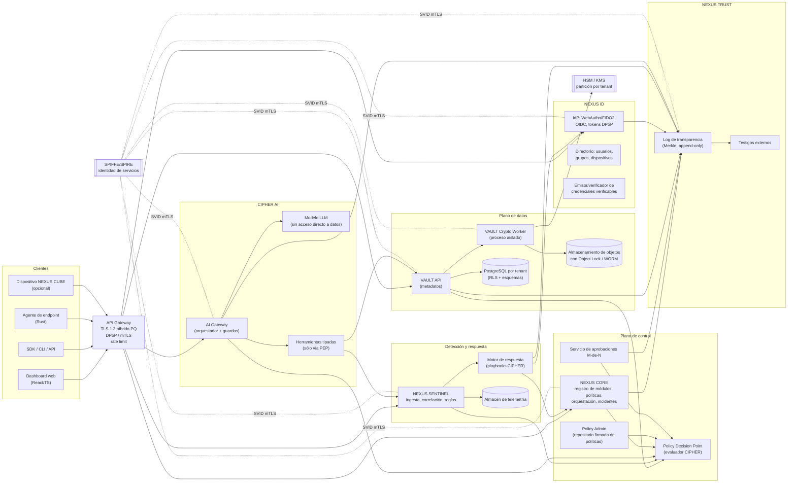
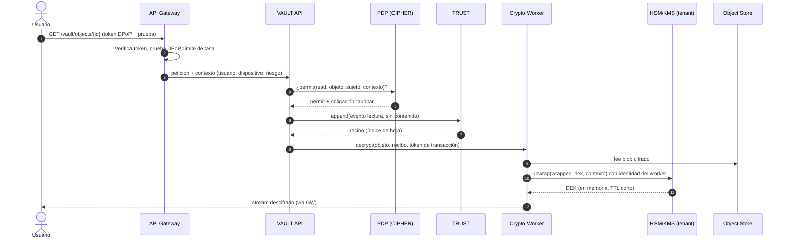
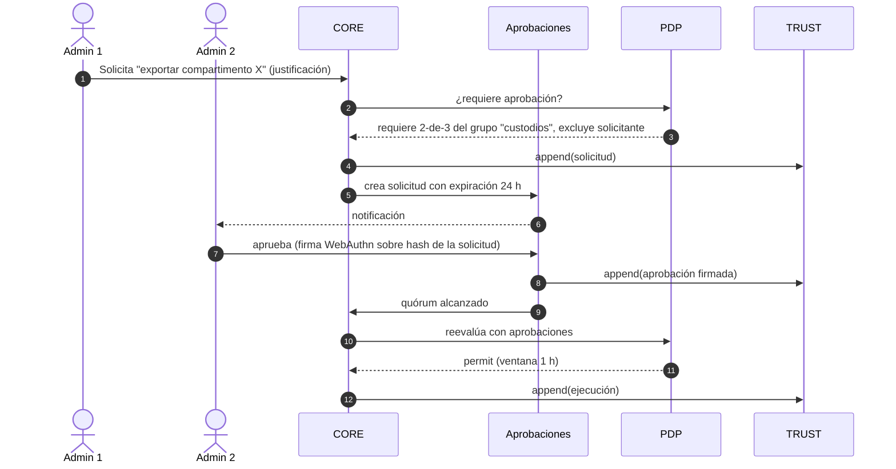
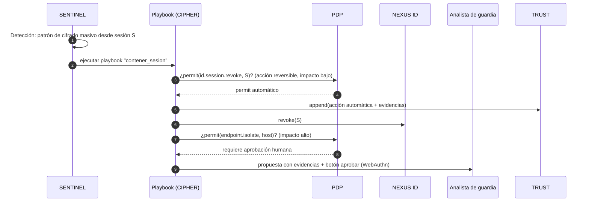

# 3. Arquitectura general

> Estado: borrador de Etapa 2. Ningún componente existe todavía.

## 3.1 Principios arquitectónicos

1. **Zero Trust real**: toda petición (humana o de servicio) se autentica y autoriza individualmente con contexto (identidad, dispositivo, riesgo, recurso, acción).
2. **Compartimentación por tenant y por compartimento**: datos, claves, colas, caches e índices están particionados; las particiones se verifican con pruebas de aislamiento automáticas.
3. **Plano de control ≠ plano de datos**: CORE gestiona políticas y coordinación, pero **no** está en la ruta de descifrado de datos ni posee claves de datos.
4. **Autorización externa a cada módulo**: un Policy Decision Point (PDP) que evalúa políticas CIPHER compiladas. Los módulos son Policy Enforcement Points (PEP).
5. **Todo lo privilegiado deja rastro verificable** en TRUST antes de ejecutarse (registro *write-ahead*).
6. **Separación de deberes por diseño**: ningún rol puede a la vez definir una política, aprobarla y ejecutarla.
7. **Monolito modular primero** y separación en servicios sólo donde el límite de aislamiento lo justifique ([ADR-0001](adr/ADR-0001-monolito-modular-con-servicios-aislados.md)).

## 3.2 Diagrama de componentes

## 3.3 Responsabilidades y límites de cada módulo

| Módulo | Hace | No hace (límite explícito) |
|---|---|---|
| **CORE** | Registro de módulos, distribución de políticas firmadas, orquestación de incidentes, gestión de configuración de tenant | No posee claves de datos; no puede leer objetos de VAULT; no puede borrar logs |
| **PDP** | Evalúa políticas CIPHER compiladas; devuelve `permit/deny + obligaciones` | No ejecuta acciones; sin E/S salvo lectura de atributos de un caché firmado |
| **PAP** | Almacena políticas versionadas y firmadas; requiere aprobación M-de-N para publicar | No evalúa |
| **NEXUS ID** | Autenticación de humanos, emisión de tokens DPoP de vida corta, registro de dispositivos, credenciales verificables | No ve biometría; no decide autorización de recursos |
| **VAULT API** | Metadatos, versionado, compartición, cuotas | No ve claves raíz; no descifra (delegado al Crypto Worker) |
| **VAULT Crypto Worker** | Genera DEK, pide desenvoltura al KMS, cifra/descifra en streaming | Sin acceso a red salvo KMS y almacén; proceso aislado por tenant (o pool con aislamiento verificado) |
| **SENTINEL** | Ingesta, normalización (OCSF), detección (reglas CIPHER/Sigma), correlación, alertas | Acciones de respuesta sólo vía playbooks autorizados por PDP |
| **CIPHER AI** | Explicar, correlacionar, resumir, proponer acciones, consultar datos autorizados | Sin credenciales propias; sin ejecución de acciones destructivas sin aprobación humana |
| **TRUST** | Log append-only con pruebas de inclusión/consistencia; checkpoints co-firmados | No interpreta eventos; no puede ser purgado por ningún rol del tenant ni del operador sin dejar evidencia |

## 3.4 Autenticación entre servicios

- Identidad de cada carga de trabajo: **SPIFFE ID** (`spiffe://nexus/<entorno>/<servicio>`) con SVID X.509 de vida ≤ 1 h emitida por SPIRE tras atestación de nodo (TPM o identidad de instancia cloud) y de carga (selector de Kubernetes/imagen firmada).
- Transporte: **mTLS** obligatorio, TLS 1.3 con grupo híbrido.
- Autorización de servicio a servicio: lista de permisos declarada en el manifiesto del servicio y evaluada por el PDP (p. ej. "SENTINEL puede invocar `id.session.revoke`, sólo con un `incident_id` válido").
- Propagación del sujeto humano: token de transacción firmado (RFC 8693, atenuado) para que cada servicio sepa **en nombre de quién** actúa.

## 3.5 Flujos principales (diagramas de secuencia)

### 3.5.1 Lectura de un documento cifrado

### 3.5.2 Acción administrativa sensible (M-de-N)

La aprobación es una **firma WebAuthn sobre el hash de la solicitud** (no un clic), de modo que una sesión secuestrada del dashboard no basta para aprobar.

### 3.5.3 Respuesta automática de SENTINEL

## 3.6 Multi-tenancy

| Capa | Mecanismo de aislamiento | Verificación |
|---|---|---|
| Claves | TRK por tenant en partición de HSM/KMS separada | Prueba: credenciales del worker del tenant A no pueden desenvolver claves de B |
| Datos | Prefijos de almacenamiento por tenant + AAD con `tenant_id` | Prueba de mezcla de blobs entre tenants → fallo de autenticación |
| Metadatos | PostgreSQL: esquema por tenant + Row Level Security como segunda barrera; tenants enterprise/críticos en base dedicada | Pruebas de consulta cruzada en CI |
| Cómputo | Crypto Worker por tenant (enterprise) o pool con proceso efímero por petición | Pruebas de reutilización de memoria |
| Telemetría | Índices por tenant | Consulta cruzada en CI |
| IA | Contexto del modelo construido sólo con datos autorizados del solicitante; sin memoria compartida entre tenants; sin entrenamiento con datos de cliente sin contrato explícito | Pruebas de fuga entre tenants |

Modelos de despliegue: **SaaS multi-tenant**, **SaaS dedicado (single-tenant)**, **on-premises / soberano** (infraestructura crítica), **híbrido** con NEXUS CUBE físico como ancla de claves local.

## 3.7 Puntos únicos de fallo y dependencias críticas

| Componente | ¿SPOF? | Riesgo si falla | Riesgo si se compromete | Mitigación |
|---|---|---|---|---|
| PDP | Disponibilidad: sí | Todo se deniega (fail-closed) | Puede emitir `permit` falsos → **crítico** | Réplicas sin estado; políticas firmadas verificadas por cada PEP; decisiones auditadas; PEPs aplican *deny-overrides* local para invariantes (p. ej. tenant ≠ tenant) |
| HSM/KMS | Sí por tenant | Sin descifrado nuevo (DEK en caché expiran) | Exposición del tenant | Clúster HSM; cuotas y alertas de tasa de unwrap; política de acceso por identidad de worker |
| SPIRE | Sí | Sin nuevas SVIDs (expiran en ≤1 h) | Suplantación de servicios | Clave raíz en HSM; SVIDs cortas; atestación de nodo; servidor anidado por región |
| NEXUS ID | Sí | Nadie inicia sesión | Emisión de tokens falsos | Claves de firma en HSM; tokens cortos ligados a DPoP; *break-glass* offline documentado |
| TRUST | Escritura: sí | Operaciones privilegiadas bloqueadas (write-ahead) | Ocultación de eventos → detectable por testigos | Réplicas; buffer local firmado en caso de caída; testigos externos |
| CORE | Parcial | Sin cambios de política/orquestación; el plano de datos sigue | Distribución de políticas maliciosas → requiere firma M-de-N | CORE no puede firmar políticas por sí solo |
| Proveedor LLM | No (degradable) | Sin asistente de IA | Respuestas manipuladas → no ejecutan nada sin PDP | Modelo autohospedado para tenants críticos |
| Cadena de suministro de software | Sí | — | Backdoor en todos los tenants | SLSA L3, builds reproducibles, firma y verificación en despliegue, revisión de dependencias |

## 3.8 Observabilidad (sin datos sensibles)

- Logs estructurados con **esquema de campos permitidos** (allow-list); el logger rechaza campos no declarados. Prohibidos: tokens, claves, contenido de objetos, plantillas biométricas, prompts completos de IA con datos de cliente (se registran hashes y referencias).
- Métricas (Prometheus/OpenTelemetry) sin etiquetas de alta cardinalidad con PII.
- Trazas con identificadores seudónimos.
- Separación: **logs operativos** (para depurar; retención corta) ≠ **eventos de auditoría** (TRUST; retención larga, integridad verificable).

## 3.9 Despliegue y actualizaciones

- Infraestructura como código revisada (2 aprobadores) y firmada.
- Imágenes de contenedor mínimas (distroless), firmadas con Sigstore; admisión en Kubernetes sólo de imágenes firmadas por la pipeline (política de admisión).
- Despliegue progresivo (canary por región/tenant interno primero) con rollback automático por SLO.
- Actualización de agentes de endpoint y del dispositivo CUBE: paquetes firmados (`NC-SIG-2`/`NC-SIG-3`), anti-rollback por contador monótono, canal de actualización con "staged rollout".

## 3.10 Recuperación

Detallado en [07-nexus-vault.md §Recuperación](07-nexus-vault.md#78-recuperación) y en el plan de pruebas. Objetivos iniciales propuestos (a confirmar por el fundador): RPO ≤ 15 min y RTO ≤ 4 h para metadatos; RPO 0 para objetos versionados (inmutables).
