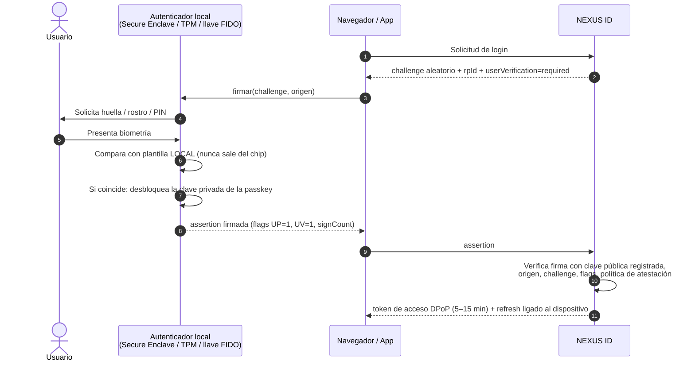

# 6. NEXUS ID — Diseño preliminar de identidad

## 6.1 Objetivos

- Autenticación **resistente a phishing por defecto** (AAL3 de NIST SP 800-63B para roles privilegiados, AAL2 mínimo para todos).
- **Biometría como gesto local de autorización**, nunca como secreto ni dato del servidor.
- Recuperación de cuenta que **no sea el eslabón débil**.
- Revocación inmediata de sesiones, dispositivos y credenciales.
- Credenciales verificables para identidad organizacional (Fase 3).

## 6.2 Cómo funciona la biometría (sin usar la huella como clave)



- La **clave criptográfica** es un par de claves generado aleatoriamente dentro del autenticador.
- La **biometría sólo decide si el chip permite usar esa clave**. Si la huella se filtra o se falsifica, el atacante sigue necesitando el dispositivo físico; si el dispositivo se pierde, la credencial se revoca y se emite otra. La huella del usuario no cambia y no se ve afectada.
- El servidor sólo recibe el flag `UV=1` firmado. **No hay plantillas en NEXUS.** (ADR-0005)

## 6.3 Niveles de credencial

| Nivel | Credencial | Uso | Requisitos |
|---|---|---|---|
| Estándar | Passkey sincronizada (iCloud Keychain, Google Password Manager, gestores compatibles) | Usuarios generales | UV requerido |
| Elevado | Passkey ligada a dispositivo con atestación (FIDO MDS, nivel certificado L1+) | Admins de tenant, analistas | Atestación verificada; lista de AAGUIDs permitidos |
| Crítico | Llave de seguridad hardware FIDO (L2+) + segunda llave de respaldo registrada | Custodios, aprobadores M-de-N, operadores de NEXUS | Dos llaves registradas obligatorias |
| Máquina | SPIFFE SVID / clave en TPM | Servicios, agentes | Atestación de nodo |

Prohibidos para niveles Elevado/Crítico: OTP por SMS, OTP por correo, preguntas de seguridad, notificaciones push sin *number matching*.

## 6.4 Ciclo de vida de dispositivos

| Evento | Flujo |
|---|---|
| Alta de dispositivo nuevo | Desde un dispositivo ya registrado (QR + CTAP hybrid) **o** con aprobación de un administrador + verificación reforzada. Notificación a todos los dispositivos existentes |
| Cambio de dispositivo | Registrar el nuevo antes de retirar el viejo; el viejo se revoca explícitamente |
| Pérdida / robo | Revocación desde otro dispositivo o por admin; revocación de todas las sesiones y tokens refresh ligados |
| Postura de dispositivo | Atributos (cifrado de disco, SO actualizado, agente presente, atestación TPM) se envían como *claims* firmados al PDP; **autenticado ≠ confiable**: un dispositivo sin postura válida obtiene permisos reducidos |

## 6.5 Recuperación de cuenta

El flujo de recuperación es el objetivo favorito de los atacantes. Diseño propuesto:

1. **Preferido:** el usuario tiene ≥2 credenciales (p. ej. passkey + llave de respaldo). No hay "recuperación", sólo uso de la otra credencial.
2. **Recuperación asistida (usuarios estándar):**
   - Solicitud → notificación inmediata a todos los dispositivos y correo registrado.
   - Verificación de identidad: admin del tenant **más** uno de: verificación documental + prueba de vida (proveedor externo evaluado ISO/IEC 30107-3), o confirmación del responsable directo.
   - **Periodo de espera** (p. ej. 24–72 h según nivel) durante el que el usuario legítimo puede cancelar desde cualquier dispositivo.
   - La nueva credencial empieza con permisos reducidos durante un periodo de observación.
3. **Roles críticos:** recuperación sólo con quórum M-de-N de custodios + verificación presencial o videollamada registrada.
4. **Recuperación de datos ≠ recuperación de cuenta:** recuperar la cuenta **no** concede acceso a datos E2EE sin los shares de recuperación del compartimento (ver VAULT).

## 6.6 Verificación documental y prueba de vida

- Sólo para alta de identidad de alto nivel (IAL2) o recuperación.
- Realizada por proveedor especializado bajo contrato de encargado de tratamiento; NEXUS recibe **resultado + nivel de confianza + referencia**, no imágenes ni plantillas, salvo que la regulación del cliente exija retención (decisión documentada con DPIA).
- Riesgos: deepfakes e inyección de vídeo virtual. Exigir detección de ataques de inyección (no sólo presentación) y evaluación por laboratorio acreditado [VALIDACIÓN EXTERNA].

## 6.7 Sesiones y tokens

| Token | Vida | Ligadura | Revocación |
|---|---|---|---|
| Access token | 5–15 min | DPoP (clave no exportable en navegador vía WebCrypto, o en TPM) | Lista de revocación distribuida + vida corta |
| Refresh token | ≤ 12 h (usuarios), ≤ 1 h (privilegiados) | Dispositivo + DPoP; rotación en cada uso con detección de reutilización | Inmediata |
| Token de transacción (delegación) | ≤ 5 min | Atenuado: alcance ⊆ alcance del sujeto (RFC 8693) | Expira |
| Step-up | Por operación | Nueva assertion WebAuthn sobre el hash de la operación | — |

## 6.8 Credenciales verificables y ZKP (Fase 3, investigación)

- Emisión de credenciales W3C VC 2.0 / SD-JWT VC para atributos organizacionales ("empleado activo de X", "custodio autorizado").
- Divulgación selectiva con SD-JWT primero (madura y sencilla); BBS y ZKP generales como línea de investigación.
- Caso de uso: un proveedor externo verifica que un técnico pertenece a la organización sin acceso al directorio.
- Riesgo: complejidad de revocación (status lists) y vinculación entre presentaciones.

## 6.9 Ataques de suplantación considerados

| Ataque | Control |
|---|---|
| Phishing AiTM | WebAuthn ligado al origen |
| Fatiga MFA (push bombing) | Sin push sin number matching; passkeys |
| SIM swapping | Sin SMS para roles elevados |
| Ingeniería social al soporte | Soporte no puede recuperar cuentas solo; flujo con periodo de espera y quórum |
| Deepfake en verificación | Proveedor con detección de inyección; nunca factor único |
| Robo de cookie de sesión | DPoP + vida corta + detección de cambio de clave |
| Registro de autenticador malicioso | Atestación + lista de AAGUIDs en niveles elevados |

## 6.10 Modelo de datos (preliminar)

```
users(id, tenant_id, display_name, status, assurance_level, created_at)
credentials(id, user_id, type[passkey|security_key], credential_id, public_key_cose,
            aaguid, attestation_fmt, sign_count, backup_eligible, backup_state,
            created_at, last_used_at, revoked_at)
devices(id, tenant_id, user_id, platform, posture_claims_jsonb, attested_at, revoked_at)
sessions(id, user_id, device_id, dpop_jkt, created_at, expires_at, revoked_at)
recovery_requests(id, user_id, method, status, cooldown_until, approvals[], created_at)
```
Sin columnas de biometría. Una prueba de CI rechaza migraciones que introduzcan nombres de columna de una lista de términos biométricos (control de higiene, no de seguridad completa).
