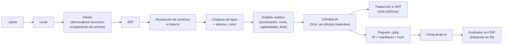

# 8. CIPHER — Diseño preliminar del lenguaje

> Estado: diseño v0.1 [ORIGINAL]. Sin implementación. La gramática y el sistema de tipos deben revisarse por un especialista en lenguajes y métodos formales antes de implementarse.

## 8.1 Filosofía

CIPHER **no** es un lenguaje de propósito general. Es un lenguaje para tres cosas, que hoy se escriben en tres lenguajes distintos sin seguridad de tipos compartida:

1. **Políticas de autorización** (quién puede hacer qué, sobre qué, en qué contexto).
2. **Reglas de detección** (qué patrón de eventos es sospechoso).
3. **Playbooks de respuesta** (qué acciones tomar, con qué salvaguardas).

Principios:
- **Seguro por defecto**: todo lo no permitido explícitamente está denegado; toda acción con efecto declara su efecto en el tipo.
- **Total**: todo programa termina. Sin recursión general ni bucles no acotados; sólo iteración sobre colecciones finitas con límites de coste estáticos.
- **Sin autoridad ambiental**: un programa no puede abrir archivos, sockets, ni llamar a criptografía arbitraria. Sólo usa **capacidades** que el host le entrega y que el manifiesto declara.
- **Analizable**: el subconjunto de políticas es traducible a lógica decidible (SMT) para responder preguntas como "¿puede alguien fuera del grupo X leer el compartimento Y?".
- **Sin criptografía propia**: las operaciones criptográficas son funciones opacas del host que llaman a bibliotecas auditadas; el lenguaje ni siquiera tiene tipos para manipular bytes de claves.
- **Explicable**: cada decisión produce una traza (qué regla, qué atributos) apta para auditoría y para la IA.

## 8.2 Objetivos de seguridad del lenguaje

| ID | Objetivo | Mecanismo |
|---|---|---|
| C1 | Un programa no puede obtener más autoridad de la declarada | Sistema de efectos + capacidades verificadas en carga |
| C2 | Un programa siempre termina en tiempo acotado | Totalidad + presupuesto de coste estático y en ejecución |
| C3 | Los secretos no pueden filtrarse a logs o salidas | Tipo `Secret<T>` sin `Display`/serialización; sólo consumible por funciones del host |
| C4 | Las políticas son deterministas | Sin reloj/aleatoriedad implícitos (el tiempo entra como atributo de la petición) |
| C5 | Las políticas firmadas no pueden alterarse | Paquete compilado firmado (`NC-SIG-2`) y verificado por el PDP |
| C6 | Errores de tipo y de atributos ausentes no conceden acceso | Evaluación de errores → `deny` (con error trazado), nunca `permit` |

## 8.3 Sintaxis (ejemplos)

### Política de autorización

```cipher
module acme.vault.policies
version 3

import nexus.std.{Principal, Device, Resource, Request}

entity Compartment { owner_group: Group, classification: Classification, mode: VaultMode }

/// Los miembros del grupo propietario pueden leer si su dispositivo cumple postura.
permit read_compartment
  when action == vault::Read
   and resource is Compartment
   and principal in resource.owner_group
   and device.posture.disk_encrypted
   and device.posture.os_supported
   and request.assurance >= AAL2

/// Datos clasificados como "restringido" exigen credencial de nivel crítico.
forbid read_restricted_without_aal3
  when action == vault::Read
   and resource.classification == Restricted
   and request.assurance < AAL3

/// La exportación siempre requiere 2 aprobaciones de custodios distintos del solicitante.
require_approval export_compartment
  when action == vault::Export
  quorum 2 of group("custodians") excluding principal
  expires 24h
```

Semántica de combinación: **forbid prevalece sobre permit**; sin `permit` aplicable ⇒ deny; `require_approval` convierte un `permit` en `pending` hasta reunir el quórum.

### Regla de detección

```cipher
module acme.detections
version 1

detection mass_encryption
  severity high
  attack ["T1486"]
  over window 5m group_by session
  where event is vault::ObjectWritten
  having count() > 200
     and avg(event.entropy_estimate) > 7.5
     and distinct(event.extension_changed) > 0.5 * count()
  emit Alert { session: key, evidence: sample(10) }
```

### Playbook de respuesta

```cipher
module acme.playbooks
version 2

playbook contain_mass_encryption
  on alert mass_encryption
  uses cap id.session.revoke, cap vault.freeze, cap endpoint.isolate
{
  // Acciones reversibles y de bajo impacto: automáticas.
  let s = alert.session
  do id.session.revoke(s)           : Effect<Reversible>
  do vault.freeze(s.compartments)   : Effect<Reversible>

  // Impacto alto: el tipo obliga a pasar por aprobación humana.
  propose endpoint.isolate(s.device.host)
    requires approval quorum 1 of role("oncall")
    timeout 30m
}
```

El compilador **rechaza** `do endpoint.isolate(...)` porque la firma de la capacidad declara `Effect<Disruptive>`, y las acciones disruptivas sólo pueden usarse con `propose … requires approval`.

## 8.4 Gramática formal (EBNF, subconjunto v0.1)

```ebnf
program        = module_decl, version_decl, { import_decl }, { declaration } ;
module_decl    = "module", qualified_name ;
version_decl   = "version", INT ;
import_decl    = "import", qualified_name, [ ".", "{", ident_list, "}" ] ;

declaration    = entity_decl | policy_decl | detection_decl | playbook_decl
               | function_decl | const_decl ;

entity_decl    = "entity", IDENT, "{", field_list, "}" ;
field_list     = [ field, { ",", field } ] ;
field          = IDENT, ":", type ;

policy_decl    = [ doc_comment ], policy_kind, IDENT, "when", expr, [ approval_clause ] ;
policy_kind    = "permit" | "forbid" | "require_approval" ;
approval_clause= "quorum", INT, "of", selector, [ "excluding", expr ], [ "expires", DURATION ] ;

detection_decl = "detection", IDENT,
                 "severity", severity, [ "attack", "[", string_list, "]" ],
                 "over", "window", DURATION, [ "group_by", path ],
                 "where", expr, [ "having", agg_expr ], "emit", record_expr ;

playbook_decl  = "playbook", IDENT, "on", "alert", IDENT,
                 "uses", cap_list, block ;
cap_list       = "cap", qualified_name, { ",", "cap", qualified_name } ;
block          = "{", { statement }, "}" ;
statement      = let_stmt | do_stmt | propose_stmt | if_stmt | for_stmt ;
let_stmt       = "let", IDENT, [ ":", type ], "=", expr ;
do_stmt        = "do", call_expr, [ ":", type ] ;
propose_stmt   = "propose", call_expr, "requires", "approval", approval_tail ;
approval_tail  = "quorum", INT, "of", selector, [ "timeout", DURATION ] ;
if_stmt        = "if", expr, block, [ "else", block ] ;
for_stmt       = "for", IDENT, "in", expr, "limit", INT, block ;   (* iteración acotada *)

function_decl  = "fn", IDENT, "(", [ param_list ], ")", "->", type, "=", expr ; (* sin recursión *)
const_decl     = "const", IDENT, ":", type, "=", literal ;

expr           = or_expr ;
or_expr        = and_expr, { "or", and_expr } ;
and_expr       = not_expr, { "and", not_expr } ;
not_expr       = [ "not" ], cmp_expr ;
cmp_expr       = add_expr, [ cmp_op, add_expr ] ;
cmp_op         = "==" | "!=" | "<" | "<=" | ">" | ">=" | "in" | "is" | "has" ;
add_expr       = mul_expr, { ("+" | "-"), mul_expr } ;
mul_expr       = unary, { ("*" | "/"), unary } ;
unary          = primary, { ".", IDENT | call_suffix | "[", expr, "]" } ;
primary        = literal | path | call_expr | record_expr | list_expr | "(", expr, ")" ;
call_expr      = qualified_name, call_suffix ;
call_suffix    = "(", [ expr, { ",", expr } ], ")" ;
record_expr    = IDENT, "{", [ IDENT, ":", expr, { ",", IDENT, ":", expr } ], "}" ;
list_expr      = "[", [ expr, { ",", expr } ], "]" ;
path           = IDENT, { "::", IDENT } ;
qualified_name = IDENT, { ".", IDENT } ;

type           = IDENT, [ "<", type, { ",", type }, ">" ] | "[", type, "]" ;
literal        = INT | FLOAT | STRING | DURATION | "true" | "false" ;
DURATION       = INT, ( "s" | "m" | "h" | "d" ) ;
```

Notas: sin `while`, sin recursión (comprobado por análisis del grafo de llamadas), `for` exige `limit` literal.

## 8.5 Sistema de tipos

| Categoría | Tipos |
|---|---|
| Primitivos | `Bool`, `Int` (64 bits con desbordamiento = error → deny), `Decimal`, `String`, `Duration`, `Timestamp` |
| Seguridad | `Principal`, `Group`, `Role`, `Device`, `Resource`, `Action`, `AssuranceLevel` (ordenado), `Classification` (retículo) |
| Colecciones | `[T]` (lista finita), `Set<T>`, `Map<K,V>` |
| Opcionales | `Option<T>` — acceso a atributo ausente requiere `has` o produce error de tipo |
| Secretos | `Secret<T>`: no comparable, no imprimible, no serializable; sólo pasable a capacidades que lo aceptan |
| Datos no confiables | `Tainted<T>`: valores provenientes de telemetría/entrada externa; no pueden usarse como nombres de capacidad, destinos de red ni en `require_approval` sin `validate::<T>()` |
| Efectos | `Effect<Pure>`, `Effect<Reversible>`, `Effect<Disruptive>`, `Effect<Destructive>` |

Reglas destacadas:
- Las políticas (`permit/forbid`) sólo pueden contener expresiones `Pure`.
- `do` admite `Reversible`; `Disruptive` sólo vía `propose`; `Destructive` (borrado, revocación de claves) **no** puede aparecer en playbooks: sólo en flujos administrativos M-de-N.
- Inferencia de tipos local (Hindley-Milner simplificado sin polimorfismo de rango superior), anotaciones obligatorias en firmas públicas.

## 8.6 Sistema de permisos (capacidades)

Cada paquete CIPHER incluye un **manifiesto**:

```toml
[package]
name = "acme.playbooks"
version = "2.0.0"

[capabilities]
"id.session.revoke" = { effect = "Reversible", rate_limit = "100/h" }
"vault.freeze"      = { effect = "Reversible", rate_limit = "20/h" }
"endpoint.isolate"  = { effect = "Disruptive", requires_approval = true }

[signing]
required_signers = 2
signer_group = "policy-approvers"
```

- El compilador verifica que el código sólo usa capacidades declaradas.
- El PDP/CORE verifica en carga que el manifiesto está firmado por el quórum y que las capacidades no exceden las concedidas al tenant.
- En ejecución, cada invocación de capacidad pasa de nuevo por el PDP (defensa en profundidad) y se registra en TRUST.

## 8.7 Pipeline de compilación



Decisiones:
- **Implementación en Rust** (seguridad de memoria, buen ecosistema de parsers, posibilidad de compilar el evaluador a WebAssembly para el dashboard y el CUBE).
- **Interpretar IR**, no generar código nativo: menor superficie, determinismo y coste medible. El rendimiento esperado de políticas compiladas a IR es suficiente (a validar con benchmarks; objetivo p99 < 1 ms por decisión).
- **Evaluador de referencia** pequeño (objetivo: < 3 000 líneas) diseñado para verificación formal futura (p. ej. con Lean/Coq/Dafny, o verificación con Kani/Verus para Rust).

## 8.8 Análisis estático

| Análisis | Detecta |
|---|---|
| Totalidad | Recursión, bucles sin límite |
| Coste | Cota superior de pasos de evaluación por política/regla; se rechaza si excede el presupuesto |
| Efectos | Uso de efectos no permitidos en el contexto |
| Taint | Datos externos usados en posiciones sensibles |
| Políticas (SMT) | Políticas que conceden acceso universal; políticas en conflicto; políticas muertas (nunca aplican); cambios de semántica entre versiones ("¿qué accesos nuevos concede esta versión?") |
| Lints de seguridad | `permit` sin condición de tenant/grupo; comparaciones de clasificación invertidas; aprobaciones sin `excluding principal` |

La **diferencia semántica entre versiones** se muestra a los aprobadores antes de firmar: "Esta versión concede *Read* sobre *Compartment[finance]* a 3 grupos que antes no lo tenían".

## 8.9 Integración con NEXUS CORE

- CORE distribuye paquetes `.cpkg` firmados a las réplicas del PDP; el PDP verifica firma y hash antes de cargar.
- Las réplicas reportan el hash de la política activa → CORE y el dashboard muestran qué versión rige en cada región.
- Detecciones: SENTINEL carga el subconjunto `detection`.
- Playbooks: el motor de respuesta (SOAR) ejecuta el subconjunto `playbook` con capacidades inyectadas por CORE.
- Interoperabilidad: importador de Sigma → `detection`; exportación de políticas a formato Cedar como verificación cruzada (estudio de viabilidad).

## 8.10 Pruebas del lenguaje

- Tests unitarios del lexer/parser/typechecker con corpus de programas válidos e inválidos.
- **Fuzzing** del parser y del typechecker (cargo-fuzz / AFL++), y fuzzing **diferencial** entre el evaluador de producción y el de referencia.
- Tests de propiedades (proptest): determinismo, monotonicidad de `forbid`, "error ⇒ deny".
- Tests de políticas escritos en el propio CIPHER:

```cipher
test "un analista no puede exportar sin aprobación" {
  given principal = user("ana", groups: ["analysts"])
  given resource  = Compartment { owner_group: group("finance"), classification: Internal, mode: Managed }
  expect decide(vault::Export) == Pending
}
```

## 8.11 Documentación prevista

Especificación del lenguaje (referencia normativa), guía de usuario, librería estándar, catálogo de capacidades, guía de migración desde Rego/Sigma, y "cookbook" de patrones seguros.

## 8.12 Riesgos específicos

- Un bug del evaluador es un bug de autorización global → evaluador mínimo + verificación formal + fuzzing diferencial.
- Expresividad insuficiente → presión para añadir "escape hatches" (llamadas externas). **Regla**: ninguna llamada externa desde políticas; los atributos se precargan.
- Adopción: aprender un lenguaje nuevo es una barrera → dashboard con editor guiado y plantillas.
