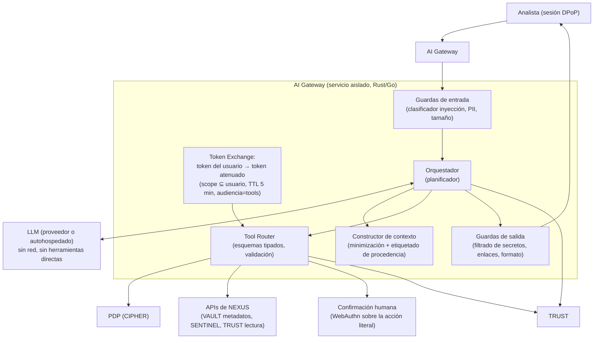
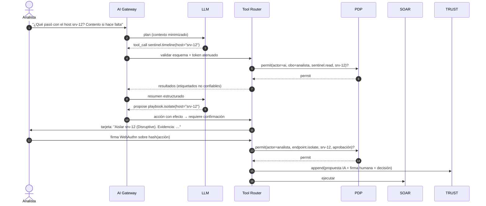

# 9. CIPHER AI — Arquitectura

## 9.1 Premisa de diseño

**Se asume que el modelo será manipulado.** No existe hoy una defensa completa contra prompt injection (en particular la indirecta, a través de datos que el modelo lee). Por tanto, la seguridad de CIPHER AI no depende de que el modelo "se porte bien", sino de que **no pueda hacer nada que el usuario solicitante no pudiera hacer por sí mismo, y nada con efecto sin confirmación humana verificable**.

## 9.2 Capacidades previstas

| Capacidad | Efecto | Requiere confirmación |
|---|---|---|
| Interpretar y explicar eventos/alertas | Lectura | No |
| Correlacionar alertas, construir línea temporal | Lectura | No |
| Consultar telemetría y metadatos autorizados | Lectura (con token del usuario) | No |
| Generar informes de incidente (borrador) | Escritura en borradores del usuario | No |
| Recomendar acciones | Ninguno | — |
| Proponer ejecución de playbook | Efecto vía SOAR | **Sí**, firma WebAuthn del humano |
| Redactar políticas/detecciones CIPHER | Borrador | Publicación sigue flujo M-de-N normal |

No tiene: acceso a claves, a contenido E2EE, a herramientas de red arbitrarias (fetch de URLs), a ejecución de código, ni memoria persistente entre tenants.

## 9.3 Componentes

## 9.4 Controles contra los riesgos solicitados

| Riesgo | Controles (capas) |
|---|---|
| **Prompt injection directa** | Instrucciones del sistema fijas; guardas de entrada (señal); pero el control real es que el modelo no tiene autoridad propia |
| **Prompt injection indirecta** | Datos no confiables (logs, tickets, correos) se envuelven con etiquetas de procedencia y se pasan como datos, no instrucciones; patrón **planificador/lector**: el LLM que planifica llamadas a herramientas no ve contenido no confiable sin procesar, sólo resúmenes estructurados de un LLM "lector" sin herramientas [EXPERIMENTAL — eficacia a medir] |
| **Extracción de información** | Contexto construido sólo con datos que el usuario puede leer (consultados con su token atenuado); sin datos de otros tenants en ninguna parte del pipeline; filtrado de salida de patrones de secretos; sin memoria compartida |
| **Abuso de herramientas** | Herramientas con esquema JSON estricto y validación de argumentos en el Tool Router (no en el modelo); límites de tasa y de volumen por sesión; lista blanca de herramientas por rol; sin herramienta de egress |
| **Manipulación de contexto** | Contexto inmutable firmado por el orquestador (hash en TRUST); el modelo no puede editar el historial; resúmenes de memoria regenerados desde fuentes, no desde salidas previas del modelo |
| **Escalamiento de privilegios** | Token atenuado (RFC 8693) con scope ⊆ usuario; el PDP evalúa cada llamada con `actor=ai, on_behalf_of=user`; las políticas pueden restringir más a la IA que al usuario (nunca menos) |
| **Autoautorización** | Imposible por construcción: el AI Gateway no tiene identidad con permisos de escritura de política ni de aprobación; las aprobaciones exigen firma WebAuthn humana sobre el hash de la acción |
| **Exfiltración por salida** (p. ej. markdown con imagen a URL externa) | Render de salida sin carga de recursos externos; enlaces sólo a dominios internos; CSP estricta en el dashboard |
| **Envenenamiento de datos de entrenamiento** | No se entrena con datos de clientes sin contrato explícito; ajuste fino sólo con datasets curados y versionados |

## 9.5 Flujo de una acción propuesta por la IA

En el registro de auditoría queda separado **qué propuso la IA** y **qué aprobó el humano**, para evitar el "lo hizo la IA" como repudio.

## 9.6 Selección del modelo

- Abstracción de proveedor (interfaz única) para permitir: API comercial con acuerdo de no retención de datos, o modelo autohospedado (pesos abiertos) para tenants críticos/soberanos.
- Evaluación obligatoria por versión de modelo: batería de tareas de seguridad + corpus de inyección + pruebas de fuga. Un cambio de modelo es un cambio de release.
- Si se usan modelos de Anthropic: verificar identificadores y políticas de retención vigentes en la documentación oficial antes de integrar [VERIFICAR].

## 9.7 Métricas de evaluación (objetivos, no resultados)

| Métrica | Objetivo de aceptación |
|---|---|
| Acciones con efecto ejecutadas sin confirmación humana | **0** (bloqueante) |
| Llamadas a herramienta que exceden el scope del usuario y llegan al backend | **0** (bloqueante) |
| Datos de otro tenant presentes en contexto | **0** (bloqueante) |
| Tasa de inyecciones que alteran el plan del modelo | Se mide y se reporta; **no** es criterio de seguridad, sí de calidad |
| Precisión de resúmenes de incidente (evaluación humana) | A definir con analistas |

## 9.8 Límites honestos

- La IA puede producir conclusiones incorrectas con apariencia convincente. Toda salida se marca como generada y enlaza a la evidencia.
- El patrón planificador/lector reduce pero no elimina la manipulación del plan.
- El análisis de la IA no sustituye al analista ni a un servicio de respuesta a incidentes.
