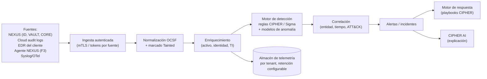
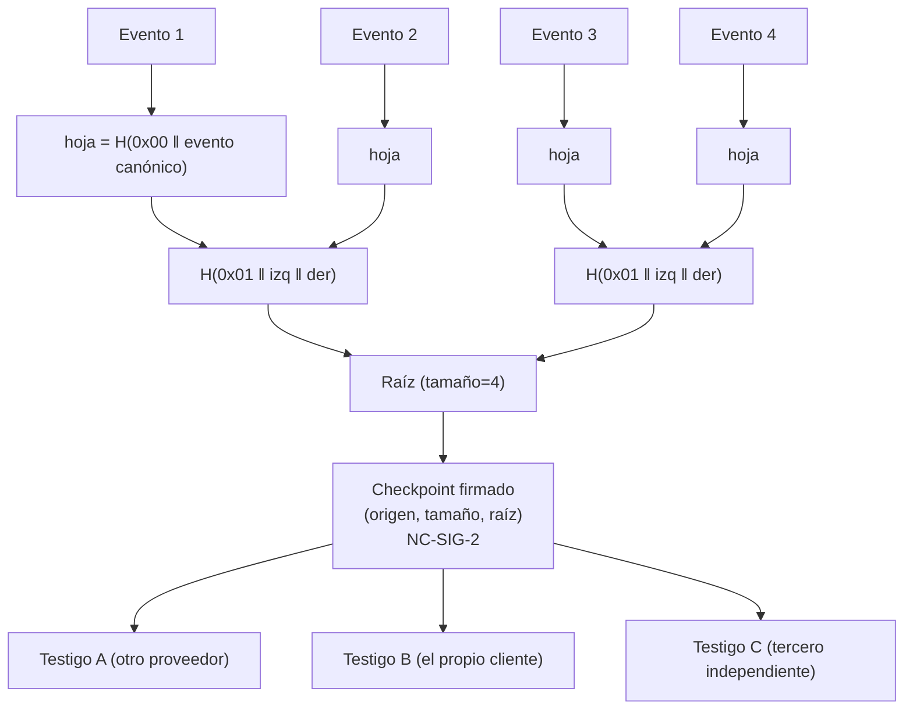

# 10. NEXUS SENTINEL y NEXUS TRUST — Diseño preliminar

## Parte A — NEXUS SENTINEL

### A.1 Alcance por fases

| Fase | Alcance |
|---|---|
| 1–2 | Detección sobre eventos propios de NEXUS (ID, VAULT, CORE) + ingesta de logs del cliente (IdP, cloud audit logs) + integración con EDR existente vía API |
| 3 | Agente de endpoint propio ligero (inventario, postura, telemetría básica, aislamiento de red) |
| 4 | Análisis de red (NDR) y detección avanzada |

Construir un EDR completo desde cero es un esfuerzo de años; en v1 se **integra**, no se compite.

### A.2 Pipeline

### A.3 Detección

- **Reglas deterministas** (CIPHER `detection`, importación Sigma) mapeadas a ATT&CK.
- **Anomalías** (UEBA): líneas base por usuario/servicio (volumen de lectura, horario, geografía, tasa de unwrap). Los modelos producen **señales con puntuación**, nunca acciones directas.
- **Canarios / honeytokens**: objetos y credenciales señuelo en VAULT; cualquier uso = alta confianza.
- **Ransomware**: combinación de tasa de escritura, entropía, cambio de extensiones, canarios y borrado de versiones (ver VAULT §7.5).

### A.4 Respuesta automatizada con salvaguardas

| Clase | Ejemplos | Automatización |
|---|---|---|
| Reversible / bajo impacto | Revocar sesión, forzar reautenticación, congelar compartimento (sólo lectura), bloquear token API | Automática con límites de tasa |
| Disruptiva | Aislar host, deshabilitar usuario, bloquear IP en perímetro | Propuesta + aprobación humana (salvo política explícita del tenant para casos con canario) |
| Destructiva | Revocar claves, borrar datos, reimagen | **Nunca automática**; flujo administrativo M-de-N |

Salvaguardas adicionales:
- **Activos protegidos**: lista (p. ej. controladores de dominio, sistemas OT) sobre los que no se ejecutan acciones disruptivas automáticas.
- **Disyuntor**: si se superan N acciones automáticas en T minutos, el motor pasa a modo "sólo propuestas" y alerta.
- **Modo simulación** ("dry-run") obligatorio para playbooks nuevos durante un periodo de observación.
- **Reversión**: cada acción reversible registra su inversa.

### A.5 Control de falsos positivos

- Métricas por regla: alertas, verdaderos positivos confirmados, descartadas, tiempo de triaje.
- Reglas con precisión < umbral pasan automáticamente a "sólo registro" y se notifica al autor.
- Supresiones con expiración obligatoria y justificación (auditadas).

### A.6 Gestión de incidentes

Estados: `nuevo → triaje → investigación → contención → erradicación → recuperación → cerrado → lecciones aprendidas`. Cada transición queda en TRUST. Plantillas de informe alineadas con NIST SP 800-61 (rev. 3 publicada en 2025 [VERIFICAR]) y con los plazos de notificación regulatorios aplicables (configurables por tenant; la interpretación legal es responsabilidad del cliente).

---

## Parte B — NEXUS TRUST

### B.1 Qué registra

Accesos (permit/deny relevantes), cambios de permisos y políticas, consultas (incluidas las de la IA), operaciones administrativas, incidentes y sus transiciones, respuestas automáticas, operaciones criptográficas (rotaciones, unwraps agregados), acciones de recuperación, aprobaciones M-de-N y accesos del personal del operador.

**Nunca**: contenido de objetos, secretos, tokens, biometría, prompts completos con datos de cliente (se guarda hash + referencia al artefacto cifrado en VAULT si debe conservarse).

### B.2 Estructura

- **Un log por tenant** (y uno de plataforma para el operador), de modo que un cliente puede verificar el suyo sin ver los de otros.
- **Pruebas de inclusión**: cada recibo (`audit_receipt`) permite comprobar que el evento está en el log.
- **Pruebas de consistencia**: cualquier verificador comprueba que el log nuevo extiende al anterior (sin reescrituras).
- **Testigos**: co-firman checkpoints sólo si son consistentes con el último que vieron → un operador malicioso no puede mostrar historias distintas a distintas partes ("split view") sin ser detectado, salvo que todos los testigos colusionen.
- Formato de checkpoint compatible con el ecosistema de "transparency log checkpoints" (tlog) para reutilizar herramientas existentes.

### B.3 Escritura write-ahead

Las operaciones privilegiadas no se ejecutan hasta obtener recibo del log. Si TRUST no está disponible, se usa un buffer local en el servicio firmado con su SVID y sellado con hash encadenado; al recuperarse se integra y se señala el hueco temporal en el dashboard.

### B.4 Protección frente a administradores maliciosos

| Ataque | Resultado |
|---|---|
| Borrar un evento | Rompe consistencia → testigos y cliente lo detectan |
| Reescribir la base de datos y re-firmar | Requiere clave de firma (HSM, M-de-N) y aun así testigos rechazan la inconsistencia |
| No registrar un evento (omisión) | Mitigado por write-ahead (la operación no ocurre sin recibo) y por correlación con logs de HSM/cloud |
| Retención: purgar eventos antiguos | Permitido sólo por política de retención pública; se purgan hojas pero se conservan hashes → la estructura sigue verificable |

### B.5 Verificador independiente

Herramienta de línea de comandos de código abierto (Fase 2) para que el cliente o un auditor verifiquen inclusión, consistencia y firmas sin depender de NEXUS. **Publicar el verificador es parte de la propuesta de confianza.**
