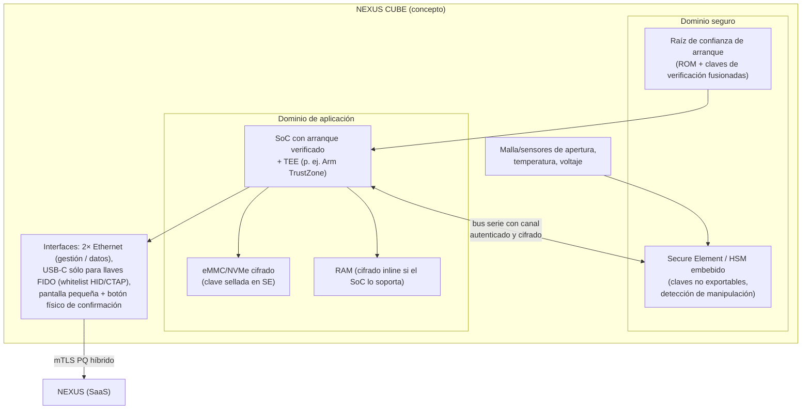
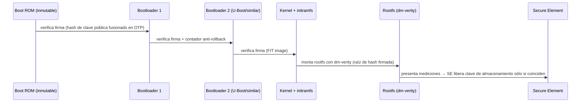

# 11. Dispositivo físico NEXUS CUBE

> **Importante:** esta sección es un **prototipo conceptual**. Un diseño fabricable requiere ingeniería de hardware especializada, análisis de cadena de suministro, cumplimiento EMC/seguridad eléctrica y, para mercados regulados, certificación (FIPS 140-3, Common Criteria) que lleva típicamente 12–24 meses y costes significativos [VALIDACIÓN EXTERNA]. Ningún componente ha sido seleccionado ni probado.

## 11.1 Propósito

Ancla de confianza local para organizaciones que necesitan que sus claves raíz y la verificación de su log de auditoría no dependan exclusivamente de la nube:
1. Custodia de la **TRK del tenant** (modo HYOK local).
2. **Testigo** de TRUST controlado por el cliente.
3. Autoridad local para **aprobaciones M-de-N** en sitio (con llaves FIDO de los custodios).
4. Gateway de telemetría local (opcional).

No es un firewall ni un servidor de almacenamiento.

## 11.2 Arquitectura conceptual

## 11.3 Cadena de arranque verificado

Firmas de firmware: `NC-SIG-3` (LMS o SLH-DSA) para resistencia poscuántica a largo plazo, verificadas por la etapa que lo soporte; donde la ROM sólo soporte ECDSA/RSA, la cadena clásica se mantiene y la PQ se añade en etapas superiores (documentar esta limitación).

## 11.4 Componentes posibles (familias, no selección)

| Función | Opciones a evaluar | Criterio |
|---|---|---|
| SoC | NXP i.MX 8/9 (HAB/AHAB, CAAM), STM32MP2, Raspberry Pi CM5 sólo para prototipo de laboratorio | Arranque seguro documentado, soporte de largo plazo, TEE |
| Secure Element | NXP SE05x/SE050E, Infineon OPTIGA Trust M, Microchip ATECC608B; o módulo HSM embebido | Certificación CC EAL6+ / FIPS, algoritmos soportados, soporte PQC [VERIFICAR] |
| TPM | Infineon SLB 9672 o similar (TPM 2.0, FIPS 140-2/3) | Atestación de plataforma |
| Almacenamiento | eMMC industrial | Ciclos de escritura, temperatura |
| Anti-manipulación | Interruptores de apertura, malla flexible, sensores de luz/temperatura/voltaje | Respuesta: borrado de claves en SE |
| Carcasa | Aluminio mecanizado con tornillería de seguridad y sellos de evidencia | Evidencia de manipulación (no prevención absoluta) |

**Ruta recomendada:** Fase 2–3 usar hardware comercial existente (HSM USB/red certificados + llaves FIDO) para validar el producto; diseñar hardware propio sólo con demanda comprobada (Fase 4+).

## 11.5 Actualizaciones seguras

- Esquema A/B con arranque de respaldo; la nueva imagen se marca válida sólo tras auto-test.
- Paquetes firmados con quórum de firmantes de release (2-de-3) y registrados en log de transparencia (Sigstore/Rekor u homólogo propio).
- Contador anti-rollback monótono en SE/eFuses.
- El cliente puede fijar una política de "aprobar actualizaciones manualmente".

## 11.6 Amenazas físicas

| Ataque | Mitigación conceptual | Residual |
|---|---|---|
| Apertura del chasis | Sensores → borrado de claves | Atacante con laboratorio avanzado |
| Sniffing del bus SoC–SE | Canal autenticado y cifrado (p. ej. SCP03 o equivalente) | Bajo |
| Glitching de voltaje/reloj | Protecciones del SE; arranque del SoC endurecido | Medio para SoC comerciales |
| Puerto de depuración (JTAG) | Deshabilitado por fusibles en producción | — |
| Robo del dispositivo completo | Requiere quórum de llaves de custodios para operaciones; revocación remota | — |

## 11.7 Diferencia prototipo vs. fabricable

| Aspecto | Prototipo conceptual (Fase 2–3) | Diseño fabricable (Fase 4+) |
|---|---|---|
| Hardware | Placa de desarrollo + SE en placa de evaluación | PCB propia, revisión de diseño, DFM/DFT |
| Seguridad física | Ninguna real | Malla, sensores, carcasa, pruebas de laboratorio |
| Firmware | Yocto/Buildroot con secure boot de evaluación | Claves de producción en ceremonia, provisión en fábrica segura |
| Certificación | Ninguna | FIPS 140-3 / CC, CE/FCC |
| Cadena de suministro | Distribuidores | Proveedores cualificados, trazabilidad, inspección |
