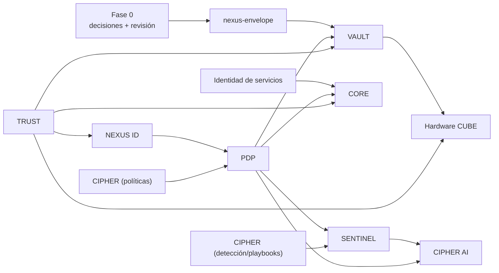

# 14. Hoja de ruta, complejidad, recursos y dependencias

> Las duraciones son **estimaciones de orden de magnitud** para planificación, con alta incertidumbre (±50 %). Dependen del tamaño y la experiencia del equipo, que aún no está definido.

## 14.1 Fases

### Fase 0 — Fundamentos (≈ 1–2 meses)
- Decisiones del fundador ([preguntas](16-preguntas-fundador.md)).
- Revisión externa de este documento por criptógrafo y arquitecto de seguridad.
- Repositorio con CI, firma de commits, protección de ramas, SCA, SAST y plantillas de ADR.
- DFDs detallados y modelo de amenazas v2.
**Salida:** arquitectura aprobada, presupuesto, equipo inicial.

### Fase 1 — Prototipo de un componente (≈ 2–3 meses)  
**Componente:** `nexus-envelope` — librería Rust de envoltura de claves de VAULT:
- Formato `NCOBJ v1` (§2.4), AEAD `NC-AEAD-1`, envoltura `NC-WRAP-1` contra un KMS simulado y contra SoftHSM (PKCS#11).
- Vinculación de contexto por AAD; zeroización; rechazo de suites desconocidas.
- Vectores de prueba propios + Wycheproof para AEAD.
- Fuzzing del parser de cabecera; tests de propiedades (mezcla entre tenants falla, rollback de versión falla).
- CBOM generado automáticamente.

**Por qué este componente:** pequeño, crítico, verificable de forma aislada, y base de VAULT. Errores aquí serían catastróficos, por eso se valida primero.

**Criterio de salida:** ver [plan de pruebas §15.4](15-plan-pruebas.md#154-criterios-objetivos-de-aprobación-y-rechazo) + revisión criptográfica externa sin hallazgos críticos abiertos.

En paralelo (diseño, no código de producción): especificación completa de CIPHER v0.2 y prototipo del parser.

### Fase 2 — MVP de piloto cerrado (≈ 6–9 meses)
> Ajuste tras la ronda 1: el MVP es **NEXUS CUBE Desktop para Windows** + NEXUS Server gestionado (región compatible para Colombia) + portal de distribución. El dashboard web de administración se mantiene sólo para los administradores. Pilotos con 2–5 empresas colombianas.
- NEXUS ID (passkeys, DPoP, dispositivos, recuperación con periodo de espera).
- PDP con CIPHER (sólo subconjunto de políticas) + análisis SMT básico.
- VAULT modo gestionado + versionado + Object Lock + restauración.
- TRUST con log por tenant, checkpoints y un testigo externo + verificador CLI de código abierto.
- Dashboard: módulos 1, 4, 6, 10, 12, 15.
- Pentest externo + auditoría de código de componentes críticos.
**Salida:** 2–5 clientes piloto con datos no críticos; SOC 2 Type I iniciado.

### Fase 3 — Producto (≈ 9–12 meses)
- SENTINEL (ingesta, reglas, correlación, respuesta con salvaguardas) e integración con EDRs.
- CIPHER detecciones y playbooks; evaluador de referencia y verificación formal parcial.
- CIPHER AI (sólo lectura + propuestas con confirmación).
- VAULT E2EE y HYOK; KEM híbrido PQ en envoltura de destinatarios.
- Credenciales verificables (SD-JWT VC).
- Agente de endpoint ligero.
- Red team externo; SOC 2 Type II; ISO 27001.

### Fase 4 — Expansión (≥ 12 meses)
- Hardware NEXUS CUBE (diseño fabricable, certificaciones).
- Despliegue soberano/on-prem para infraestructura crítica.
- FROST/umbral, ZKP, TEEs.
- Validación FIPS 140-3 del módulo criptográfico (si el mercado lo exige).

## 14.2 Estimación de complejidad por módulo

| Módulo | Complejidad | Motivo principal | Riesgo técnico |
|---|---|---|---|
| CORE + PDP | Alta | Corrección de autorización en todos los caminos | Alto |
| NEXUS ID | Alta | Recuperación, compatibilidad de autenticadores, UX | Medio |
| VAULT | Alta | Criptografía + streaming + inmutabilidad + recuperación | Alto |
| CIPHER (lenguaje) | Muy alta | Diseño de lenguaje, tipos, SMT, verificación | Alto |
| CIPHER AI | Media-Alta | Defensas contra inyección, evaluación continua | Alto (problema abierto) |
| SENTINEL | Muy alta (si se construye EDR) / Media (si se integra) | Volumen de datos, calidad de detección | Medio |
| TRUST | Media | Reutiliza tlogs existentes | Bajo-Medio |
| Dashboard | Media | 15 módulos, accesibilidad | Bajo |
| Hardware | Muy alta | NRE, certificación, cadena de suministro | Muy alto |

## 14.3 Recursos (equipo mínimo orientativo)

| Fase | Perfiles |
|---|---|
| 0–1 | 1 arquitecto/a de seguridad (líder técnico), 1 ingeniero/a Rust con experiencia criptográfica, consultor criptógrafo externo (por horas), asesor legal de privacidad (por horas) |
| 2 | + 2 backend (Go/Rust), 1 frontend, 1 SRE/plataforma, 1 especialista en identidad, ½ diseñador UX; pentest externo |
| 3 | + 1–2 ingenieros de lenguajes/compiladores, 2 ingeniería de detección, 1 ML/IA, 1 GRC/cumplimiento; red team externo |
| 4 | + equipo de hardware (2–4) o socio ODM, laboratorios de certificación |

## 14.4 Dependencias

Dependencias externas críticas: proveedor de HSM/KMS, proveedor cloud, bibliotecas criptográficas auditadas, proveedor de verificación documental/prueba de vida, proveedor o modelo LLM, testigos externos de TRUST, laboratorios de certificación.

## 14.5 Costes a estimar (no estimados aquí)

No se dan cifras económicas sin datos del mercado objetivo, país y estructura salarial. Partidas a presupuestar: equipo, HSM/KMS, infraestructura cloud, auditorías y pentests, certificaciones (SOC 2, ISO 27001, FIPS 140-3, CC), asesoría legal multi-jurisdicción, seguros de ciberriesgo, y en Fase 4 NRE de hardware.
