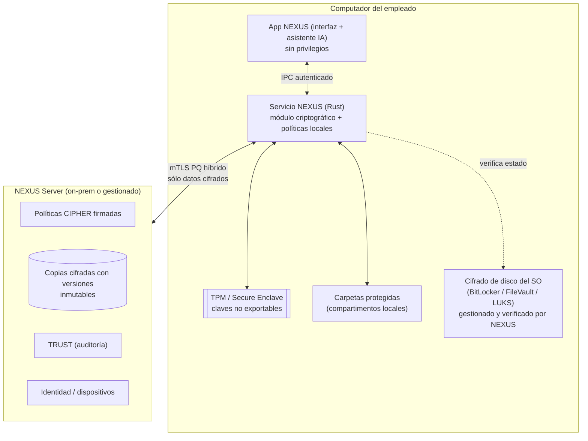

# 17. NEXUS CUBE Desktop — El sistema se instala en el computador

> Decisión del fundador (ronda 1): "El sistema debe instalarse en el computador para que pueda cifrar toda la información del personal o de las empresas." Este documento adapta la arquitectura a un modelo **local-first** (los datos se cifran primero en el equipo). Ver [ADR-0009](adr/ADR-0009-local-first-aplicacion-escritorio.md). Estado: diseño, sin implementar.

## 17.1 Cambio de arquitectura

La arquitectura de [03](03-arquitectura-general.md) se mantiene, con un cambio de centro de gravedad:

| Antes (versión 0.1) | Ahora |
|---|---|
| Dashboard web como interfaz principal | **Aplicación instalada** (Windows, macOS, Linux) como interfaz principal |
| El cifrado ocurre sobre todo en el servidor (Crypto Worker) | El cifrado ocurre **en el equipo**: el servidor recibe datos ya cifrados |
| La IA corre en el servicio | Asistente en la app; el modelo puede ser local o remoto, siempre sin claves |

Los servidores siguen existiendo para coordinar empresas (políticas, compartir archivos entre empleados, copias de seguridad cifradas, auditoría TRUST). Pueden ser **NEXUS Server on-premise** (en la empresa) o **gestionados por NEXUS**, y en ambos casos almacenan **sólo texto cifrado** de los datos de usuario.

## 17.2 Qué significa "cifrar toda la información"

Se combinan tres capas, porque ninguna sola basta:

| Capa | Protege contra | No protege contra |
|---|---|---|
| **1. Cifrado de disco completo** (BitLocker/FileVault/LUKS: se usa el del sistema operativo, ya probado; NEXUS lo exige, lo verifica y custodia las claves de recuperación con M-de-N) | Robo o pérdida del equipo apagado | Malware ejecutándose con el equipo encendido |
| **2. Carpetas protegidas** con cifrado por archivo (NEXUS) | Otros usuarios del equipo, procesos no autorizados, copias de archivos fuera del equipo | Malware que actúa como el propio usuario mientras la carpeta está abierta |
| **3. Copias cifradas con versiones inmutables** en NEXUS Server | **Ransomware y borrado**: aunque cifre o borre los archivos, las versiones anteriores sobreviven | — |

**Advertencia:** cifrar los archivos *no* detiene el ransomware, porque el ransomware puede volver a cifrar archivos ya cifrados. Lo que permite recuperarse es la **capa 3** (versiones inmutables), junto con la detección de SENTINEL. Este punto debe comunicarse con precisión a los clientes.

## 17.3 Componentes en el equipo

| Componente | Lenguaje | Privilegio | Función |
|---|---|---|---|
| Servicio NEXUS | Rust | Servicio del sistema (mínimo necesario) | Criptografía, políticas locales, sincronización, telemetría de seguridad |
| App de usuario | Rust + Tauri (UI web local, sin navegador remoto) [a evaluar] | Usuario | Interfaz, asistente IA, confirmaciones |
| Integración con el sistema de archivos | Fase 2: unidad virtual en espacio de usuario (FUSE / macFUSE o File Provider / WinFsp o ProjFS) | Usuario/servicio | Abrir y guardar archivos cifrados de forma transparente |
| Controlador de kernel | **Evitarlo** en las primeras fases | Kernel | Sólo si una función imprescindible lo exige, con revisión dedicada |

> Por qué evitar el kernel: un fallo en un agente de seguridad dentro del kernel puede tumbar miles de equipos a la vez (por ejemplo, el incidente de un EDR comercial en julio de 2024 que dejó inservibles millones de equipos Windows). El espacio de usuario reduce ese riesgo.

## 17.4 Claves en el equipo

- La clave del dispositivo se genera dentro del **TPM 2.0** (Windows/Linux) o del **Secure Enclave** (macOS) y no se puede exportar.
- El usuario la desbloquea con **Windows Hello / Touch ID** o con un PIN: la biometría es local ([ADR-0005](adr/ADR-0005-biometria-solo-local.md)).
- Cada carpeta protegida tiene su propia clave (Compartment Key), envuelta para cada dispositivo autorizado (HPKE híbrido, `NC-WRAP-2`).
- Requisito mínimo de hardware: **TPM 2.0** (obligatorio en Windows 11). Los equipos sin TPM funcionan en un modo degradado claramente señalado, o no se admiten (decisión pendiente, P-D1).

### 17.4.1 Qué implica exigir TPM 2.0 (ejemplo)

**Contexto:** Windows 11 exige TPM 2.0 para instalarse, y Microsoft terminó el soporte de Windows 10 el 14 de octubre de 2025 (salvo actualizaciones de seguridad extendidas de pago, ESU) [VERIFICAR condiciones vigentes]. Casi todos los equipos de empresa fabricados desde ~2017–2018 tienen TPM 2.0, a veces como **fTPM** integrado en el procesador (Intel PTT o AMD fTPM), aunque en algunos viene **desactivado en la BIOS/UEFI**.

**Ejemplo hipotético:** una firma de abogados con 150 equipos.

| Grupo | Equipos | Situación | Qué pasa si NEXUS exige TPM 2.0 |
|---|---|---|---|
| A | 110 | Windows 11, TPM 2.0 activo | Se instala sin cambios |
| B | 25 | Windows 10, el procesador tiene fTPM pero está desactivado en la BIOS | Activar fTPM en la BIOS (≈10–15 min por equipo, con soporte de TI) y, preferiblemente, actualizar a Windows 11 |
| C | 15 | Equipos antiguos sin TPM 2.0 (anteriores a ~2016) | **No pueden usar NEXUS.** Opciones: reemplazarlos, asignarles sólo tareas sin datos sensibles, o (si se aprueba) un modo alternativo con llave FIDO2 externa |

**Ventajas de exigirlo**
- Las claves del equipo no se pueden copiar: un malware o un ladrón no se las lleva en un archivo.
- Atestación: el servidor verifica que el equipo arrancó sin manipulaciones antes de entregarle claves.
- Windows Hello (huella/rostro/PIN) protegido por hardware.
- Un único modelo de seguridad, más simple de probar y auditar.
- De todos modos, los equipos sin TPM 2.0 no pueden tener Windows 11, y Windows 10 ya no tiene soporte gratuito: **son un riesgo de seguridad en sí mismos**.

**Costes de exigirlo**
- Una evaluación previa del parque de equipos en cada cliente (NEXUS puede entregar una herramienta de diagnóstico que lo verifique antes de vender).
- Trabajo de TI para activar fTPM en la BIOS.
- Reposición de equipos antiguos (coste del cliente; puede retrasar o impedir la venta).
- Las máquinas virtuales necesitan TPM virtual (vTPM), disponible en Hyper-V, VMware y Azure.

**Alternativa intermedia (si se decide no excluir a nadie):** en equipos sin TPM, la clave del dispositivo vive en una **llave FIDO2/PIV externa** (USB). Es igual de no copiable, pero no permite atestación de arranque, añade un coste por llave y el equipo queda señalado como "postura reducida" con menos permisos (p. ej. sin acceso a compartimentos de historias clínicas o expedientes).

**Recomendación del equipo:** exigir TPM 2.0 y Windows 11 como norma, con una herramienta de diagnóstico previa a la venta; la alternativa con llave externa sólo como excepción temporal, por un plazo limitado (p. ej. 6 meses) mientras el cliente renueva equipos.

## 17.5 Funcionamiento sin conexión

- El equipo sigue cifrando y descifrando las carpetas ya autorizadas durante un periodo configurable (p. ej. 7 días) sin contactar al servidor.
- Las revocaciones se aplican al reconectar. **Riesgo:** un equipo robado y desconectado conserva el acceso hasta que expira ese periodo. Se mitiga con cifrado de disco, plazos cortos para datos sensibles y borrado remoto al reconectar.

## 17.6 Actualizaciones

- Siempre firmadas: firma del sistema operativo (Authenticode / notarización de Apple) **y** firma propia de NEXUS (`NC-SIG-2`).
- Anti-rollback (no se puede instalar una versión anterior vulnerable).
- Despliegue progresivo; la empresa puede exigir aprobación manual.
- **Nunca** se distribuyen desde la página web (ver [18](18-distribucion-segura.md)).

## 17.7 Plataformas

**Decidido (ronda 3): Windows primero.** Plataforma objetivo: Windows 11; Windows 10 sujeto a la decisión P-D1 (§17.4.1). Luego macOS y, por último, Linux. Móvil (Android/iOS) en una fase posterior, sólo para aprobaciones y lectura.

## 17.8 Nuevas amenazas que introduce este modelo

| Amenaza | Control |
|---|---|
| Malware suplanta la app para pedir confirmaciones falsas | La confirmación muestra los datos en un diálogo seguro del sistema operativo (Windows Hello / Touch ID), atado al hash de la operación |
| Manipulación del servicio local por un administrador del equipo | El servicio verifica su propia integridad; el servidor exige atestación TPM del dispositivo para entregar claves de compartimento |
| Pérdida de datos por un fallo de cifrado | Pruebas de recuperación; escritura atómica (temporal → verificación → reemplazo); copias versionadas |
| Instalador falso distribuido por atacantes | Proceso de distribución controlado (doc 18) |
