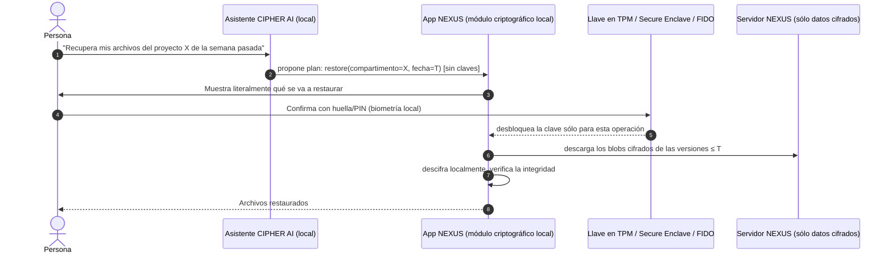

# ADR-0008 — Recuperación de información asistida por IA

**Estado:** **Aceptado** (ronda 2): el fundador aprueba la alternativa. La IA sólo guía; nunca posee ni usa las claves. Queda pendiente la ratificación del responsable de seguridad cuando se designe (Q21).

> Motivo del fundador: si la IA usara las llaves, un atacante podría manipularla para descargar toda la información.

## Contexto

Respuesta del fundador a la pregunta Q8:

> "Sí, debería de ser posible mediante la IA con las llaves criptográficas de la persona; eso descarga la información almacenada de la persona. Como cada llave criptográfica es única de cada persona, es complejo que lo hackeen."

La propuesta entra en conflicto con dos reglas innegociables:
- **Regla 4:** la IA no puede tener acceso irrestricto a claves.
- **ADR-0004:** la IA no tiene credenciales propias.

### Análisis

1. **Que cada clave sea única es bueno, pero no impide el robo.** La unicidad limita el radio de impacto: robar la clave de Ana no expone los datos de Luis (propiedad P1). Sin embargo, los atacantes reales no adivinan claves: **las roban** del dispositivo comprometido, o **engañan al sistema que las custodia**. Si la IA puede usar las claves, el atacante ya no necesita robar la clave: le basta con convencer a la IA. La inyección de prompt no tiene hoy una defensa completa conocida (ver [09-cipher-ai.md](../09-cipher-ai.md)).
2. **Una IA con acceso a las claves de todos se convierte en la clave maestra** que la regla 6 prohíbe, aunque cada clave sea distinta.
3. Hay que distinguir dos situaciones:
   - **(a)** La persona **conserva** su dispositivo o su llave y quiere recuperar o descargar su información. → Se puede hacer de forma segura.
   - **(b)** La persona **perdió todas** sus llaves y dispositivos. → Por definición, sus llaves ya no se pueden usar. Hace falta otro mecanismo.

## Decisión propuesta

La IA **guía y orquesta** la recuperación, pero **nunca posee, ve ni usa las claves**.

### Caso (a): la persona tiene su llave

La experiencia es la que pidió el fundador ("la IA lo hace con mis llaves"), pero técnicamente es la **app** la que usa la llave, **sólo tras la confirmación biométrica de la persona**, y la IA nunca toca las claves.

### Caso (b): la persona perdió todo
| Mecanismo | Quién interviene | Notas |
|---|---|---|
| Recuperación organizacional M-de-N | Custodios de la empresa (p. ej. 2 de 3) | Mecanismo por defecto |
| **Fragmento de custodia NEXUS** (opcional y contratado) | NEXUS guarda 1 fragmento de un esquema 2-de-3 o 3-de-5 | NEXUS **solo** no puede recuperar nada; debe combinarse con fragmentos de la empresa. Así se respeta "sin clave maestra" |
| Ninguno (E2EE estricto) | — | Pérdida irrecuperable, aceptada contractualmente |

En los tres casos la IA puede **guiar** el procedimiento (pasos, verificación, estado), pero no lo **autoriza** ni posee fragmentos.

## Consecuencias
+ Se cumple la intención del fundador (recuperación sencilla y asistida) sin crear una clave maestra en la IA.
+ Un atacante que manipule a la IA, como mucho, consigue que *proponga* una restauración que la persona tiene que confirmar con su biometría.
− Un paso de confirmación más para el usuario.

## Alternativa descartada: IA con acceso a las claves
**Rechazada** por el fundador en la ronda 2. Cualquier funcionalidad futura que dé a la IA acceso a claves, fragmentos de recuperación o datos descifrados fuera de la sesión del usuario requiere un nuevo ADR.
